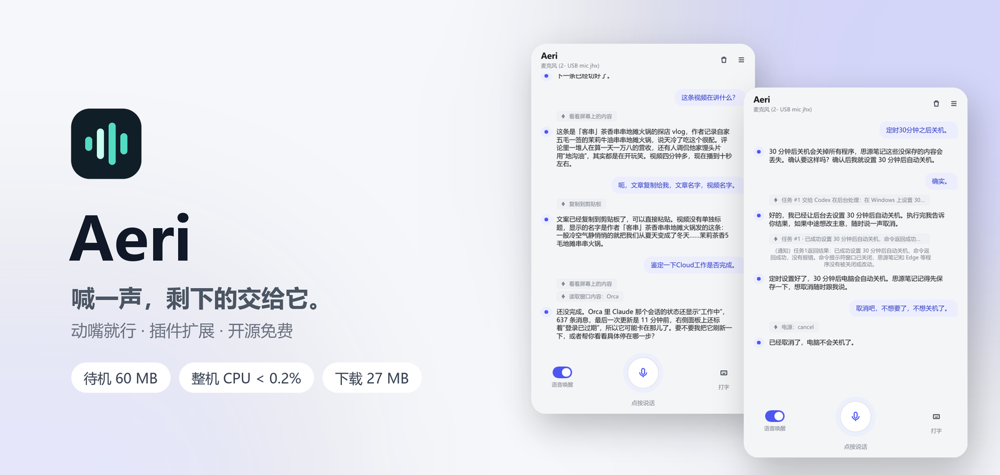
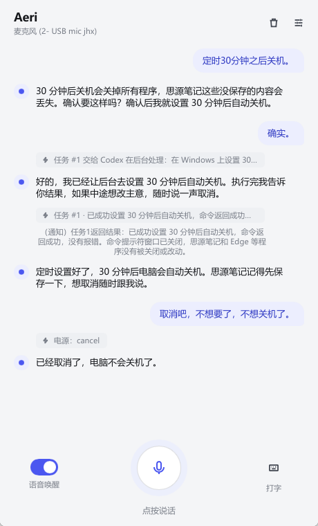
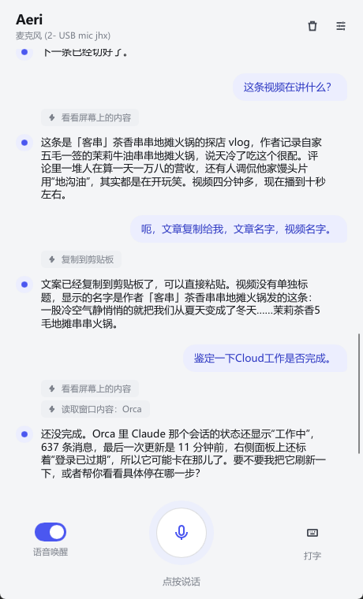
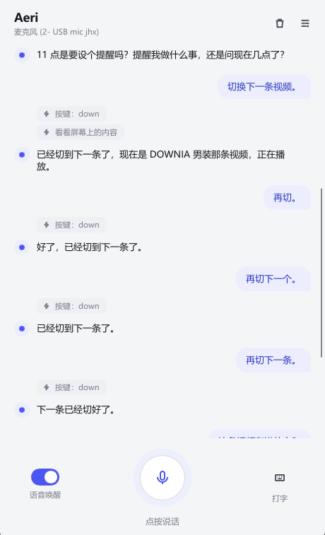

  <picture>
    <source media="(prefers-color-scheme: dark)" srcset="docs/screenshots/hero-dark.png">
    
  </picture>

  
  
  
  

  <a href="https://github.com/yuqtai/Aeri/releases/latest"><b>下载</b></a> ·
  <a href="#快速开始"><b>快速开始</b></a> ·
  <a href="docs/guide.md"><b>使用说明</b></a> ·
  <a href="https://linux.do"><b>社区</b></a>

 

## 你说，它做

> **「把这个文件改名叫周报」**
> 直接改好资源管理器里选中的文件，扩展名自动保留，不用你按 F2。

> **「这段翻译一下」**
> 读你正在看的那段文字，翻译好放进剪贴板，不用复制粘贴。

> **「30 分钟后关机」**
> 先提醒你思源里还有没保存的内容；你说「确实」才设置。改主意了说「取消吧」，马上撤销。

> **「切换下一条」「再切」**
> 刷视频时一句一个动作，手不用离开碗筷。

> **「帮我查查这几款显卡，写个对比」**
> 费时的活交给后台的 Codex / Claude Code，你照样能接着聊；做完它主动告诉你。

> **「记到思源笔记里」**
> 装了思源插件，它直接调思源的本机接口写进今天的日记，两步、几秒钟，不用点界面。

> **「十分钟后提醒我喝水」**
> 到点它会开口提醒你，重启电脑也不会丢。

> **躺在沙发上，拿起手机按住说**
> 同一个 Wi-Fi 下用安卓 App 按住说话、打字、停止、调音量，回答照常从电脑播出。见 [手机控制](docs/guide.md#手机控制安卓-app)。

## 使用截图

| 危险操作先确认，说一句就撤回 | 看懂你正在看的东西 | 动动嘴就能刷视频 |
|:---:|:---:|:---:|
|  |  |  |
| “30 分钟后关机”先提醒你保存， 说“取消吧”马上撤销 | “这条视频讲什么”直接读屏回答， 文案一句话复制走 | “切换下一条”“再切”， 一句一个动作 |

## 为什么说它轻、快

| 指标 | 实测 |
|---|---|
| 待机内存 | 约 **60 MB** |
| 待机 CPU | 整机 **不到 0.2%** |
| 下载包 | **24 MB**（含手机 App），解压即用，不要管理员权限 |
| 常用操作 | 不到 **1 毫秒**（不算网络和大模型思考） |
| 软件内更新 | 约 **9 秒** |

Rust 编写，一个进程，不带浏览器内核，不占显卡。

详细原理和完整测试数据 → [轻和快](docs/performance.md)

## 快速开始

1. 到 [Releases](https://github.com/yuqtai/Aeri/releases/latest) 下载 `Aeri-vX.Y.Z-windows-x64.zip`，解压
2. 双击 `aeri.exe`
3. 在设置里填两个 API Key，点“保存并应用”

| Key | 去哪里拿 | 用途 |
|---|---|---|
| DeepSeek | [platform.deepseek.com](https://platform.deepseek.com/api_keys) | 理解你的话、决定做什么 |
| 阿里云百炼 | [百炼控制台](https://bailian.console.aliyun.com/) | 听和说 |

想用手机操控（可选）：

1. 电脑上打开 设置 → 手机控制 → “允许手机控制”，点“保存并应用”（Windows 防火墙询问时允许“专用网络”）
2. 安卓手机装 [Releases](https://github.com/yuqtai/Aeri/releases/latest) 里的 `Aeri-vX.Y.Z-android.apk`，和电脑连同一个 Wi-Fi，打开后会自动找到电脑
3. 电脑上点“配对新手机”，把 6 位配对码填进手机

之后有新版本，设置页里点一下就能更新；手机 App 跟着电脑一起更新，手机上点一下就装好，不用再去下载。

## 更多文档

- [使用说明](docs/guide.md)：界面、全部设置项、Key 的细节
- [轻和快](docs/performance.md)：为什么轻、为什么快，完整实测
- [安全与已知限制](docs/safety.md)：它能做什么、不会做什么、哪些还没测过
- [开发与发版](docs/development.md)：架构、编译、安装、发版
- [插件](docs/plugins.md)：教 Aeri 用更多软件，怎么装、怎么写
- [状态机清单](docs/state-machines.md)：程序里每个“阶段”怎么表示、为什么

## 社区交流

[LINUX DO](https://linux.do) · 真诚、友善、团结、专业。欢迎佬友交流使用体验、反馈问题。
