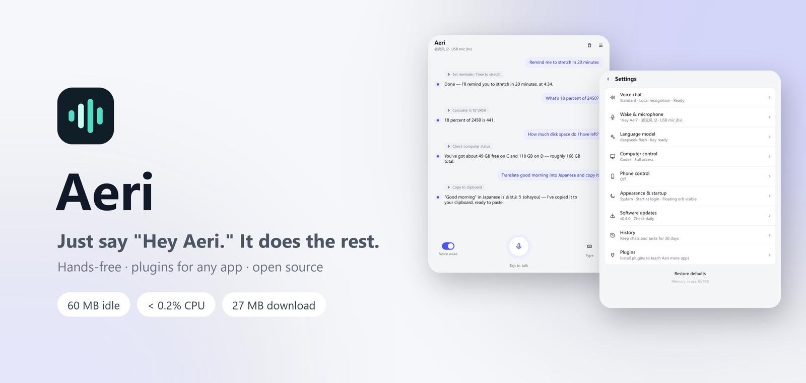
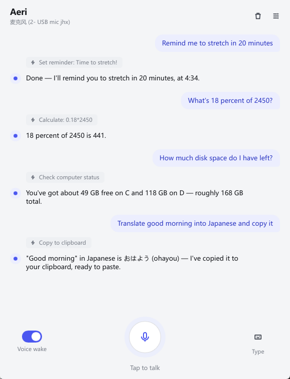
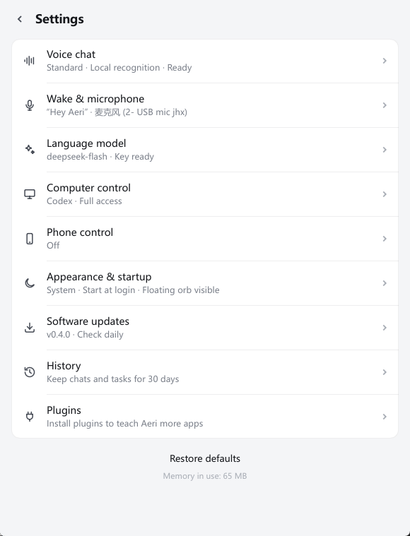
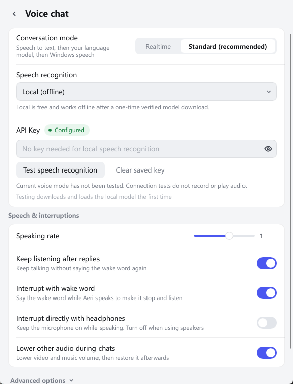

  <picture>
    <source media="(prefers-color-scheme: dark)" srcset="docs/screenshots/hero-en-dark.png">
    
  </picture>

  
  
  
  

  <b>English</b> · <a href="README.zh-CN.md">简体中文</a>

  <a href="https://github.com/yuqtai/Aeri/releases/latest"><b>Download</b></a> ·
  <a href="#quick-start"><b>Quick start</b></a> ·
  <a href="docs/plugins.md"><b>Plugins</b></a> ·
  <a href="https://github.com/yuqtai/aeri-plugins"><b>Plugin market</b></a>

 

**Aeri is a voice assistant for Windows that doesn't just talk — it does things.** Say "Hey Aeri", ask for something, and it opens apps, renames files, writes notes, changes settings, or hands longer jobs to a background agent. It idles at about 60 MB of RAM, so you can leave it running all day.

## You say it, Aeri does it

> **"Rename this file to weekly report"**
> Renames the file selected in Explorer and keeps the extension. No F2, no typing.

> **"Translate this paragraph"**
> Reads what you're looking at, translates it, and puts the result on your clipboard.

> **"Shut down in 30 minutes"**
> Warns you about unsaved work first and only sets it after you confirm. Changed your mind? "Cancel that."

> **"Next video" … "again"**
> One sentence, one action, while your hands are busy.

> **"Compare these three GPUs and write me a summary"**
> Long jobs go to a background agent (Codex or Claude Code). Keep talking meanwhile; Aeri tells you when it's done.

> **"Remind me to drink water in 10 minutes"**
> It speaks up on time, and reminders survive a restart.

> **"Add this to my Obsidian daily note"**
> With a plugin, Aeri uses the app's own link or local API instead of clicking around. Two steps, a few seconds.

## Screenshots

| Ask, and it acts | Settings | Voice, your way |
|:---:|:---:|:---:|
|  |  |  |
| Reminders, math, disk space, translation, each with the tool it used | One page per area; problems show in amber | Standard mode with free offline recognition, or realtime voice |

## Why it feels light

| | Measured |
|---|---|
| Idle memory | about **60 MB** |
| Idle CPU | **under 0.2%** of the whole machine |
| Download | **27 MB**, unzip and run, no admin rights |
| Local actions | under **1 ms** (excluding network and model thinking) |
| In-app update | about **9 s** |

One Rust process, no browser engine, no GPU use. The wake word runs locally; audio leaves your PC only after you wake Aeri, and only to the provider you chose.

## Quick start

1. Download `Aeri-vX.Y.Z-windows-x64.zip` from [Releases](https://github.com/yuqtai/Aeri/releases/latest) and unzip it.
2. Run `aeri.exe`.
3. Open **Settings**, paste an **OpenAI API key**, and click **Save**. That one key covers listening, speaking and thinking.
4. Say **"Hey Aeri"**.

Prefer another provider? Aeri also works with Anthropic, Google Gemini, OpenRouter, Groq, DeepSeek, a local Ollama model, or any OpenAI-compatible endpoint. Pick it in **Settings → LLM**.

New versions install from inside the app (Settings → Updates).

## Plugins

Built in: apps, windows, files, volume, brightness, Wi-Fi, screenshots, reminders, power, clipboard history, calculator.

**How to use a specific app** comes from plugins: short Markdown guides that teach Aeri the fastest reliable way to work with that app. They are text, not code. Browse and install them in **Settings → Plugins**, or just say "install the Obsidian plugin". Want to write one? See [yuqtai/aeri-plugins](https://github.com/yuqtai/aeri-plugins).

## Privacy

- The wake word is detected on your PC. Nothing is sent before you wake Aeri.
- After that, audio and text go only to the providers you configured, with your own keys.
- No telemetry. Conversation history stays on your PC for 30 days, and you can turn it off or clear it.
- Plugins can only call local APIs on `127.0.0.1`. App tokens they need are read on your PC and never sent to the model.

## Docs

- [User guide](docs/guide.md): setup, voice modes, providers, settings, history, and phone control
- [Performance](docs/performance.md): architecture and versioned measurements
- [Safety and limitations](docs/safety.md): access, privacy, and open verification items
- [Development](docs/development.md): architecture, builds, translations, and releases
- [Plugins](docs/plugins.md): installation, market, and app guides
- [State machines](docs/state-machines.md): lifecycle and audio routing

[中文文档](docs/zh-CN/guide.md)

## License

[MIT](LICENSE)
