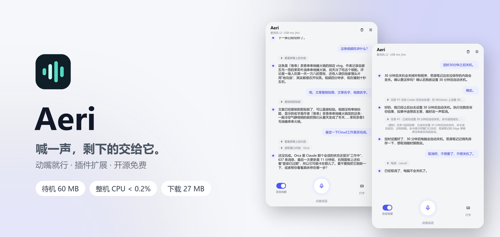
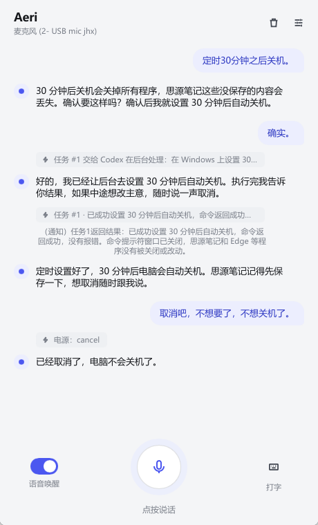
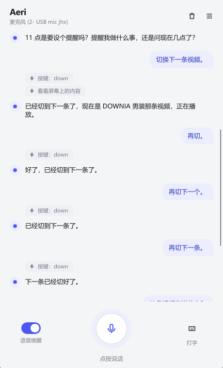

<p align="center">
  <picture>
    <source media="(prefers-color-scheme: dark)" srcset="docs/screenshots/hero-dark.png">
    
  </picture>
</p>

<p align="center">
  <a href="https://github.com/yuqtai/Aeri/releases/latest"></a>
  
  
  
</p>

<p align="center">
  <a href="README.md">English</a> · <b>简体中文</b>
</p>

<p align="center">
  <a href="https://github.com/yuqtai/Aeri/releases/latest"><b>下载</b></a> ·
  <a href="#快速开始"><b>快速开始</b></a> ·
  <a href="docs/zh-CN/guide.md"><b>使用说明</b></a> ·
  <a href="https://linux.do"><b>社区</b></a>
</p>

<br>

<h3 align="center">喊一声 "Hey Aeri"，剩下的交给它。</h3>

<table>
<tr>
<td width="33%" valign="top">
<h4>🎙️ 动嘴就行</h4>
喊一声唤醒词，说要做什么：打开软件、改文件名、调设置、设提醒，不用碰鼠标键盘。提醒到点、后台任务做完，它会主动开口告诉你。
</td>
<td width="33%" valign="top">
<h4>🧩 自己搭</h4>
用几句大白话，教它<b>你自己的</b>习惯、软件和文件夹。不用写代码、不用编译，把内置能力像积木一样拼起来；也可以直接装现成的 13 个插件。
</td>
<td width="33%" valign="top">
<h4>🪶 轻</h4>
待机约 <b>60 MB</b> 内存、整机 CPU 不到 0.2%，一个 Rust 进程，下载 27 MB，开一整天也感觉不到。
</td>
</tr>
</table>

开源（MIT），大模型随你选，接 Ollama 可以全程离线。唤醒词在本机检测，没喊之前不录音、不上传。不用注册，没有遥测。

## 你说，它做

> **「把这个文件改名叫周报」**
> 直接改好资源管理器里选中的文件，扩展名自动保留，不用你按 F2。

> **「这段翻译一下」**
> 读你正在看的那段文字，翻译好放进剪贴板，不用复制粘贴。

> **「30 分钟后关机」**
> 先提醒你思源里还有没保存的内容；你说「确实」才设置。改主意了说「取消吧」，马上撤销。

> **「切换下一条」「再切」**
> 刷视频时一句一个动作，手不用离开碗筷。

> **「帮我查查这几款显卡，写个对比」**
> 费时的活交给后台的 Codex / Claude Code，你照样能接着聊；做完它主动告诉你。

> **「记到思源笔记里」**
> 装了思源插件，它直接调思源的本机接口写进今天的日记，两步、几秒钟，不用点界面。

> **「十分钟后提醒我喝水」**
> 到点它会开口提醒你，重启电脑也不会丢。

> **躺在沙发上，拿起手机按住说**
> 同一个 Wi-Fi 下用安卓 App 按住说话、打字、停止、调音量，回答照常从电脑播出。见 [手机控制](docs/zh-CN/guide.md#手机控制安卓-app)。

## 自己搭插件

Aeri 自带一套积木：打开和关闭软件、文件和文件夹、音量、亮度、Wi-Fi、深色模式、窗口、截图、提醒、剪贴板、计算，以及软件的本机接口。**插件**就是一段大白话，把这些积木拼成适合*你这台电脑*的流程。

比如把下面这段存成 `%APPDATA%\VoiceAssistant\plugins\work-mode\PLUGIN.md`：

```markdown
---
id: work-mode
name: 上班模式
version: 1.0.0
description: 我每天早上的布置
keywords: 上班模式, 开工
---
我说“上班模式”时：
1. 打开飞书、Outlook 和 VS Code。
2. 用 VS Code 打开我的项目文件夹 D:\code\shop。
3. 音量调到 20，切换到深色模式。
4. 告诉我今天还有哪些提醒。
```

之后喊一声 **"Hey Aeri，上班模式"**，早上的工作环境就自己布置好了。不用写代码、不用编译。游戏启动、直播准备、记笔记、每天要开几十次的那个文件夹，都可以写成你自己的插件。

想要现成的？设置 → 插件 里有 13 个一键安装（Spotify、Outlook、VS Code、Slack、Notion、Obsidian、思源笔记……），也可以直接说"装一下 Spotify 插件"。自己写得好用，欢迎分享到[插件市场](https://github.com/yuqtai/aeri-plugins)。

## 使用截图

| 危险操作先确认，说一句就撤回 | 看懂你正在看的东西 | 动动嘴就能刷视频 |
|:---:|:---:|:---:|
|  |  |  |
| “30 分钟后关机”先提醒你保存，<br>说“取消吧”马上撤销 | “这条视频讲什么”直接读屏回答，<br>文案一句话复制走 | “切换下一条”“再切”，<br>一句一个动作 |

## 为什么说它轻、快

| 指标 | 实测 |
|---|---|
| 待机内存 | 约 **60 MB** |
| 待机 CPU | 整机 **不到 0.2%** |
| 下载包 | **27 MB**（含手机 App），解压即用，不要管理员权限 |
| 常用操作 | 不到 **1 毫秒**（不算网络和大模型思考） |
| 软件内更新 | 约 **9 秒** |

Rust 编写，一个进程，不带浏览器内核，不占显卡。

详细原理和完整测试数据 → [轻和快](docs/zh-CN/performance.md)

## 快速开始

1. 到 [Releases](https://github.com/yuqtai/Aeri/releases/latest) 下载 `Aeri-vX.Y.Z-windows-x64.zip`，解压
2. 双击 `aeri.exe`
3. 打开 设置 → 大模型，填一个 API Key（默认 DeepSeek，在 [platform.deepseek.com](https://platform.deepseek.com/api_keys) 创建），点“保存并应用”

语音也可以自由选择：识别可以用内置的离线模型（Moonshine、Whisper、SenseVoice、Parakeet）、本机自己搭的识别服务（Qwen3-ASR、faster-whisper 等兼容 OpenAI 接口的），或 OpenAI、Groq、Deepgram、ElevenLabs、Azure、Gemini、阿里云；朗读可以用 Windows 声音或 OpenAI、ElevenLabs、Azure。

只需要这一个 Key：语音识别默认在本机离线完成（第一次使用时自动下载模型），回答用 Windows 自带的声音读出来。想要更自然的实时语音，可以在 设置 → 语音对话 里换成实时语音：阿里云百炼、OpenAI、Azure OpenAI、xAI Grok，或任何兼容 OpenAI Realtime 接口的服务。

想用手机操控（可选）：

1. 电脑上打开 设置 → 手机控制 → “允许手机控制”，点“保存并应用”（Windows 防火墙询问时允许“专用网络”）
2. 安卓手机装 [Releases](https://github.com/yuqtai/Aeri/releases/latest) 里的 `Aeri-vX.Y.Z-android.apk`，和电脑连同一个 Wi-Fi，打开后会自动找到电脑
3. 电脑上点“配对新手机”，把 6 位配对码填进手机

之后有新版本，设置页里点一下就能更新；手机 App 跟着电脑一起更新，手机上点一下就装好，不用再去下载。

## 文档

- [使用说明](docs/zh-CN/guide.md)：安装、语音模式、服务商、设置、历史与手机控制
- [轻和快](docs/zh-CN/performance.md)：架构与注明版本的历史测量
- [安全与已知限制](docs/zh-CN/safety.md)：权限、隐私、限制和待验证项
- [开发与发版](docs/zh-CN/development.md)：架构、编译、安装、发版
- [插件](docs/zh-CN/plugins.md)：教 Aeri 用更多软件，怎么装、怎么写
- [状态机清单](docs/zh-CN/state-machines.md)：程序里每个“阶段”怎么表示、为什么

## 社区交流

[LINUX DO](https://linux.do) · 真诚、友善、团结、专业。欢迎佬友交流使用体验、反馈问题。
